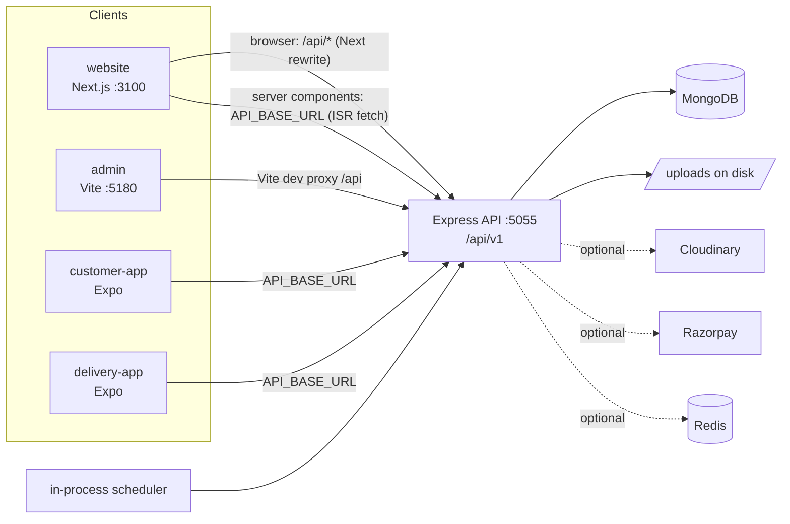
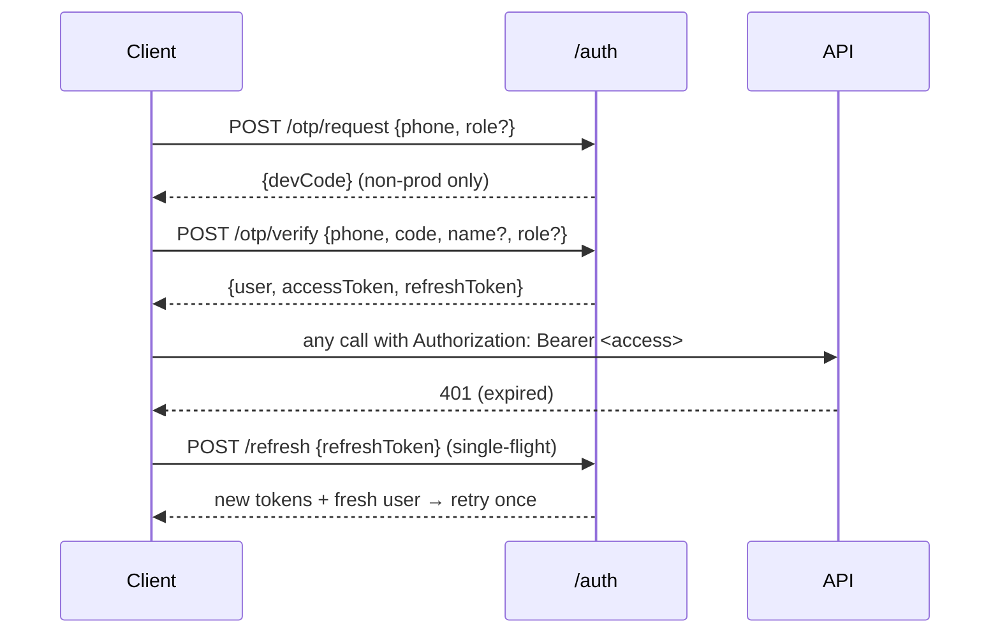
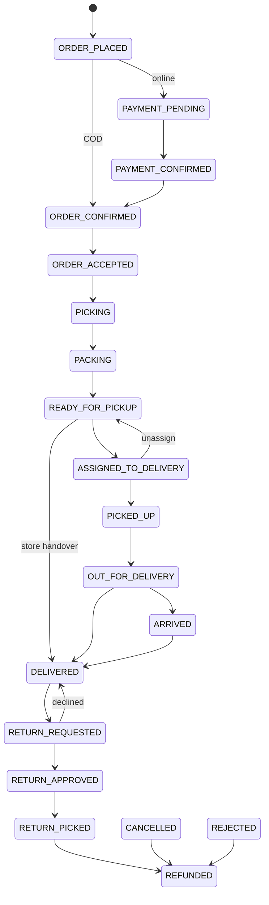

# Project Context

> Generated by reading the repository (branch `dhilipa-sep_30`). Everything below is taken from code; anything inferred is labelled **Inferred from implementation**. Secrets are never reproduced — only variable names.

---

## 1. Project Overview

| Item | Value |
| --- | --- |
| Repo / folder name | `Techb_Freshveg` |
| Brand names in code | **"Samagra Mart"** (backend settings default, customer app `app.config.js`, delivery app "Samagra Partner") and **"FreshMart"** (website: `website/app/layout.jsx`, `manifest.js`, `public/sw.js`). Inconsistent — see §25. |
| Package names | `commerce-engine-api`, `commerce-admin`, `commerce-website`, `commerce-customer-app`, `commerce-delivery-app` |
| What it is | A configurable **grocery / fresh-produce e-commerce "commerce engine"** (India-oriented: INR, paise, GST, 10-digit phone OTP login, pincode serviceability, COD). Sample data is a Hosur, Tamil Nadu store. |
| Target users | Shoppers (website + mobile app), store staff / admins (admin panel), delivery riders (partner app). |
| Problem solved | End-to-end ordering for a single- or multi-store grocer: category-driven catalogue, per-store inventory with batches/expiry, offers/coupons, wallet + loyalty + referrals, order state machine with picking/packing/delivery proof, returns/refunds, notifications, reports. |
| Status | Backend is broad and mostly complete. Admin, website, customer app and delivery app all exist and talk to the API. **Online payments, real push/SMS/email, live GPS tracking from the rider app and Stripe are not wired end-to-end** (see §26). No automated test framework; one end-to-end smoke script. |

**This repo is a monorepo of five independent apps (no root `package.json`, no workspaces):**

```text
backend/       Express + MongoDB REST API (the single source of truth)
admin/         React + Vite staff dashboard
website/       Next.js 15 storefront (SSR + PWA)
customer-app/  Expo / React Native shopper app (also runs on web)
delivery-app/  Expo / React Native rider app
```

> ⚠️ The root `README.md` is **stale and wrong** — it describes a mock-data Vite "ShopNest" frontend that does not exist in this repo. Ignore it; this file supersedes it.

---

## 2. Technology Stack

| Category | Technology | Purpose |
| --- | --- | --- |
| Backend runtime | Node.js ≥ 20 (CommonJS), Express 4 | REST API (`backend/src`) |
| Backend libs | `mongoose` 8, `zod` (middleware exists; most routes validate by hand), `jsonwebtoken`, `bcryptjs`, `helmet`, `cors`, `compression`, `morgan`, `express-rate-limit`, `dotenv` | Core API plumbing |
| Database | MongoDB (Mongoose ODM). Dev/demo: `mongodb-memory-server` | Persistence |
| Cache | In-process `Map`; Redis if `REDIS_URL` set (lazy `require("redis")` — package is **not** in `package.json`) | `backend/src/core/cache.js` |
| Authentication | JWT access + refresh tokens; phone OTP (customers, riders); phone+password (staff) | `backend/src/modules/auth` |
| Authorization | Role → permission map in code, per-user grant/revoke, `requirePermission` middleware | `auth/roles.js`, `middleware/auth.js` |
| Admin frontend | React 19, React Router 7, Vite 6, Recharts | `admin/` (port 5180) |
| Website | Next.js 15 (App Router), React 19, `next/font` Poppins, plain CSS, PWA service worker | `website/` (port 3100) |
| Mobile apps | Expo SDK 57, React Native 0.86, React Navigation 7 (bottom-tabs + native-stack), AsyncStorage, `react-native-web` | `customer-app/`, `delivery-app/` |
| State management | React Context only (no Redux/Zustand/React Query) | all frontends |
| Styling | Admin: hand-written CSS with design tokens + dark mode (`admin/src/styles/index.css`). Website: one 2.9k-line `app/globals.css`. Apps: `StyleSheet` + `theme/index.js`. No Tailwind / UI kit anywhere. | |
| Maps | **None.** (Distance maths is a hand-rolled haversine in `delivery.service.js`; no map SDK in any app.) | |
| Storage | Local disk (`uploads/`, served at `/uploads`) or Cloudinary via raw REST | `backend/src/modules/storage` |
| Payments | Razorpay (REST, hand-written) + a `manual` provider; `stripe` appears only in a settings enum | `payments/gateways.js` |
| Notifications | Template engine + channel stubs (push/SMS/email/WhatsApp **not implemented**); in-app works | `notifications/` |
| Jobs | In-process `setInterval` scheduler | `backend/src/jobs` |
| Deployment | **No Docker, CI, Procfile, vercel/netlify/eas config in the repo.** | §23 |
| Tests | `backend/src/seed/smoke.js` (1k-line E2E script). No Jest/Vitest/Playwright. | |

---

## 3. Project Structure

```text
Techb_Freshveg/
├── README.md                      # STALE (describes a different project)
├── .gitignore                     # ignores node_modules, dist, .env, .next, .expo, etc.
│
├── backend/
│   ├── .env.example
│   └── src/
│       ├── server.js              # entry: connectDb → scheduler.start → listen
│       ├── app.js                 # express app, helmet/cors, /api/health, /uploads static, mounts router
│       ├── config/                # index.js (env + dev fallbacks), db.js (mongoose connect)
│       ├── core/                  # ApiError, asyncHandler, cache, money (paise helpers), query (paginate),
│       │                          #   schemaBase (shared schema opts + money()/percent()/objectId()), sequence (atomic counters), slugify
│       ├── middleware/            # auth.js, errorHandler.js, validate.js (zod)
│       ├── routes/index.js        # mounts every module under /api/v1
│       ├── jobs/                  # scheduler.js + rules.js (abandoned carts, win-back, etc.)
│       ├── seed/                  # run.js, data.js, notificationTemplates.js, demoServer.js, memoryServer.js, smoke.js, syncIndexes.js
│       └── modules/<domain>/      # *.model.js, *.routes.js, *.service.js per domain:
│           audit, auth, cart, catalog, customers, delivery, inventory, loyalty,
│           maintenance, marketing, notifications, orders, payments, pricing,
│           referrals, reports, reviews, settings, storage, stores, support, wallet, wishlist
│
├── admin/
│   ├── vite.config.js             # port 5180, proxies /api → localhost:5055
│   └── src/
│       ├── main.jsx, App.jsx      # routes + permission <Guard>
│       ├── api/client.js          # fetch wrapper, refresh-on-401, upload()
│       ├── context/AuthContext.jsx
│       ├── components/            # Layout (nav+topbar+theme), ui.jsx (Card/Table/Modal/…), SchemaForm, FormRoute, SelectMenu, Sparkline, Icons
│       ├── pages/                 # Dashboard, Login, Offers, catalog/, orders/, payments/, inventory/, delivery/,
│       │                          #   support/, maintenance/, customers/, marketing/, reports/, settings/
│       └── styles/index.css
│
├── website/                       # Next.js App Router
│   ├── next.config.mjs            # rewrites /api/* → API_BASE_URL
│   ├── app/                       # routes (see §7) + layout, globals.css, manifest, robots, sitemap, offline
│   ├── components/                # Header, Providers (Auth/Cart/Store/Wishlist contexts), ProductCard, Filters, carousels, …
│   ├── lib/                       # api.js (server fetch, ISR), client-api.js (browser), format.js, app-icon.jsx
│   └── public/sw.js               # conservative service worker
│
├── customer-app/                  # Expo
│   ├── App.js, app.config.js
│   └── src/ api/client.js · context/{Auth,Cart,Store}Context.js · navigation/RootNavigator.js · screens/ · components/ · theme/
│
└── delivery-app/                  # Expo
    ├── App.js, app.config.js
    └── src/ api/client.js · context/AuthContext.js · navigation/RootNavigator.js · screens/ · components/ · theme/
```

---

## 4. Architecture



Key facts:
- **One API, four clients.** All clients use the same `{ success, ... }` JSON envelope and Bearer JWT. Errors: `{ success:false, error:{ message, details? } }`.
- **Website** talks to the API two ways: server components via `lib/api.js` (direct to `API_BASE_URL`, `next: { revalidate }` caching, returns `null` on failure so pages degrade to empty), and the browser via `lib/client-api.js` to same-origin `/api/v1` (Next rewrites → no CORS).
- **Admin** has no production proxy config: in production `VITE_API_BASE_URL` must point at the API (CORS is `cors()` wide open) — dev uses the Vite proxy.
- **Money** is integer **paise** everywhere (`core/money.js`); clients format with `rupees()` helpers.
- **IDs**: JSON responses expose `id` (string), never `_id`/`__v` (`core/schemaBase.js` transform; subdocs need `subdocOptions` or `id` is missing).
- **Indexes are not auto-built** (`autoIndex:false`): run `npm run sync-indexes` / seed.
- **Multi-store** is modelled via a `store` field on inventory/orders/carts/zones, one DB.

### Authentication flow

Staff: `POST /auth/staff/login {phone,password}` (admin app only).

### Order / checkout data flow
`Cart (intent only) → cartService.summarise → pricing.priceCart → orderService.placeOrder → Inventory.reserve → Order saved → wallet/loyalty debited → paymentService.initiate → Offer usage++ → cart "converted" → notify → COD: ORDER_CONFIRMED, online: PAYMENT_PENDING`.

### File upload flow
`POST /uploads?folder=…` with the **raw image bytes as body** and `Content-Type: image/*` (not multipart). Server sniffs magic bytes (JPEG/PNG/GIF/WEBP only, default 5 MB cap `MAX_UPLOAD_BYTES`), stores via provider (`local` → `${PUBLIC_URL}/uploads/<folder>/<name>` or Cloudinary), returns `{url, path, bytes, provider}`. Only the admin app calls it (`api.upload`).

---

## 5. User Roles & Permissions

Defined in `backend/src/modules/auth/roles.js`. Roles are data: effective permissions = role defaults + `grantedPermissions` − `revokedPermissions`. Permissions are baked into the JWT (`perms`) so revocation takes effect on next token refresh.

**Permission keys:** `catalog.view/manage/publish`, `inventory.view/adjust`, `orders.view/manage/assign`, `delivery.view/fulfil`, `customers.view/manage`, `marketing.view/manage`, `reports.view`, `settings.manage`, `users.manage`.

| Role | Login method | Permissions | Notes |
| --- | --- | --- | --- |
| `super_admin` | staff password | all | |
| `admin` | staff password | all except `users.manage` | Order state machine treats admin/super_admin as allowed for every transition |
| `store_manager` | staff password | catalog.view/manage, inventory.view/adjust, orders.view/manage/assign, customers.view, reports.view, marketing.view, delivery.view | |
| `picker` | staff password | catalog.view, inventory.view, orders.view, orders.manage | |
| `support` | staff password | catalog.view, orders.view, customers.view/manage | |
| `delivery_partner` | **phone OTP only** (`role:"delivery_partner"`) | delivery.view, delivery.fulfil, orders.view | Cannot self-register; account must be pre-created. Not in `STAFF_ROLES` so cannot use `/staff/login`. |
| `customer` | phone OTP (auto-creates account) | none | Customer routes check `order.customer === req.user.id` instead |

- `users.manage` and `User.stores[]` (store scoping) exist but **no route enforces store scoping, and there is no user/staff-management API or admin page** (**Inferred**: staff are created via seed/DB). `GET /auth/roles` lists roles/permissions.
- A phone number is unique **per role** (`{phone, role}` unique index).
- Admin UI hides nav items and guards routes by permission (`admin/src/App.jsx` `Guard`, `components/Layout.jsx` `NAV`). Note: **`delivery_partner` has no staff login, so cannot use the admin**; the admin Delivery page needs `delivery.view`.

### Route → required permission summary
| Area | Gate |
| --- | --- |
| Catalog read/write | `catalog.view` / `catalog.manage`; publish `catalog.publish` |
| Inventory | `inventory.view` / `inventory.adjust` |
| Orders list/detail | `orders.view`; status change `orders.manage` **or** `delivery.fulfil` (state machine decides which move); pick `orders.manage`; assign + partner list `orders.assign` |
| Delivery queue/history/deliver/ping | `requireRole(delivery_partner, admin, super_admin, store_manager)` |
| Delivery zones/slot-templates write | `settings.manage`; read `delivery.view` |
| Payments admin | `orders.view` / `orders.manage` |
| Returns (staff) | `orders.view` / `orders.manage` |
| Customers | `customers.view` / `customers.manage` |
| Offers, banners (write), templates, broadcast, referrals list | `marketing.view` / `marketing.manage` |
| Reports | `reports.view` |
| Audit | `users.manage` **or** `reports.view` |
| Settings, stores, maintenance | `settings.manage` |
| Uploads | any of `catalog.manage`, `marketing.manage`, `delivery.fulfil`, `customers.manage` |

---

## 6. Features & Modules

Status key: **Implemented / Partial / Stub**.

### 6.1 Auth & profile
- **Backend:** `modules/auth/*` — OTP request/verify (rate-limited 10/15 min per IP), staff login (20/15 min), refresh, `/me`, address CRUD, roles reference.
- **Frontend:** admin `Login.jsx`; website `Providers.jsx` + `/login`, `/account`; customer app `LoginScreen`, `AccountScreen`; delivery app `LoginScreen`, `ProfileScreen`.
- **DB:** `User`, `Otp` (hashed code, TTL index 1 h after expiry).
- **Rules:** OTP 6 digits, 5 min expiry, 5 attempts. First OTP for a customer phone creates the account (referral code auto-generated). Blocked users rejected. OTP is returned in the response as `devCode` when `NODE_ENV !== production`.
- **Status:** Implemented; **SMS delivery is a TODO** (code is only `console.log`ged).

### 6.2 Catalogue (category-driven schema)
- **Purpose:** Categories carry *feature flags* (`featureRegistry.js`: weightBased, perishable, batchTracking, expiryTracking, returnable, codAllowed, ageRestricted, prescriptionRequired, fragile, taxInclusivePricing, allowSubstitution) and *attribute bindings*, inherited down the tree (nearest wins). `GET /catalog/categories/:id/schema` returns the form definition; the admin `SchemaForm` renders the product form from it (no per-category code).
- **Backend:** `catalog/*` — `catalog.routes.js` (staff), `storefront.routes.js` (public, `optionalAuth`), `category.service`, `product.service`, `schema.service`, `featureRegistry`.
- **DB:** `Attribute`, `Category` (tree + `categoryPath`), `Brand`, `Product`, `Variant` (the sellable unit with SKU/price).
- **Frontend:** admin `catalog/{Categories,Attributes,Products,ProductForm,Brands,Reviews}.jsx`; website `/c`, `/c/[slug]`, `/p/[slug]`, `/search`; customer app Home/Categories/ProductList/ProductDetail/Search.
- **Rules:** Product `status` draft→active→hidden→archived; publishing needs `catalog.publish`. Product rolls up `priceFrom/To`, `inStock`, `soldOut` from variants/inventory (`product.service.refreshRollup`, `inventory.refreshVariantStock`). Loose/weight goods use `stepQty`<1 and fractional quantity.
- **Status:** Implemented.

### 6.3 Inventory
- `inventory/*`: one row per (store, variant); `onHand`, `reserved`, `damaged`, batches (FEFO picking order). Movements logged in `StockMovement`. Endpoints: list, low-stock, expiring, movements, receive, adjust, damage, transfer.
- **Rules:** `available = onHand − reserved`. Checkout *reserves*; `DELIVERED` *dispatches* (decrements onHand+reserved); cancel/reject *releases*. Returns restock (`receive`) or write-off damaged.
- **Status:** Implemented. Reservation is a read-then-write (not atomic/transactional) — see §25.

### 6.4 Cart & pricing
- `cart/*` (guest cart via `X-Session-Id`, merge on login, save-for-later, coupon, wallet/loyalty credits) and `pricing/pricing.service.js` (single place totals are computed; used for cart preview, checkout and order snapshot).
- **Pricing pipeline (`priceCart`):** line totals → catalogue savings (MRP−price) → candidate offers (active, auto + typed coupon, priority desc) → combinability → discount allocation across eligible lines → delivery charge (free via offer or `freeDeliveryAbove`) → packaging → tax per line (inclusive split or exclusive add) → wallet → loyalty points (**1 point = 10 paise hard-coded**, ignores `Settings.loyalty.pointValuePaise`) → **round total to nearest rupee** (`roundOff`).
- **Offer types:** `percentage`, `fixed`, `free_delivery`, `bogo`, `cashback` implemented; **`free_item` is in the enum but `computeReward` returns nothing for it** (not implemented). `conditions.customerTags`, `newCustomerDays`, `limits.perCustomer/totalUses` — only `firstOrderOnly` and `usedCount` increments are visibly used in pricing (**Inferred**; verify before relying).
- **Status:** Implemented.

### 6.5 Orders & fulfilment
See §15–16. Files: `orders/{order.model,order.routes,order.service,orderStatus,return.routes}.js`.
- **Status:** Implemented (placement, state machine, pick, assign, OTP-verified delivery, cancel, rate, tracking view).

### 6.6 Delivery
- `delivery/*`: serviceability + quote (`/delivery/quote`), slots (`/delivery/slots`, from `DeliverySlot` templates), zones (polygon > pincode > radius), rider ping + latest position (`DeliveryTracking`), delivery reports.
- Rider app uses `/orders/delivery/queue|history`, `/orders/:id/status`, `/orders/:id/deliver` (OTP). Earnings = deliveries today × `Store.settings.partnerFeePerDelivery`; COD cash held = sum of COD totals delivered today.
- **Status:** **Partial.** The backend supports live position (`POST /delivery/orders/:id/ping`, `GET …/position`) but **no client calls these** (rider app does not send GPS; customer apps do not read it; no map UI). Proof photo/signature fields exist on the order but the rider app never uploads them.

### 6.7 Payments & refunds
- `payments/*`: methods, initiate, confirm (HMAC-verified Razorpay), webhook, COD collect/outstanding/settle, refunds (wallet / source / cash).
- **Status:** **Partial.** `onlineEnabled` defaults to **false** and provider `none`; Razorpay needs `RAZORPAY_KEY_ID/SECRET`(+`RAZORPAY_WEBHOOK_SECRET`). Website and customer app show UPI etc. as **"Gateway pending"** and never call `/payments/*`; only COD completes end-to-end from clients. `stripe` is accepted in settings but has no provider (resolves to manual).

### 6.8 Wallet, loyalty, referrals
- `wallet.service` / `loyalty.service` write ledgers (`WalletTransaction`, `LoyaltyTransaction`) and update `User.walletBalance` / `loyaltyPoints`. Loyalty earn on delivery (`rupeesPerPoint` 100), expiry job. Referral: claim a code; reward settled on referee's first delivered order (min order value in settings). Cashback from offers credited to wallet on delivery.
- **Status:** Implemented. Wallet "topup" reason exists; no top-up endpoint exists (confirmed by grep).

### 6.9 Returns
- `orders/return.routes.js` mounted at `/returns`. Eligibility per item from category feature `returnable` + `returnWindowDays` (fallback 7 days). Flow in §16. Admin: `Returns.jsx`.
- **Status:** Backend + admin implemented. **No customer-facing return UI** found in website/customer app (**Inferred** — no `/returns` calls there).

### 6.10 Reviews & wishlist
- `reviews/*`: reviews only for DELIVERED orders (verified), moderation (`pending/published/rejected`, controlled by `Settings.app.reviewsNeedApproval`), helpful votes, rating roll-up on product. Website `ReviewsPanel`, customer app `CustomerReviews`.
- `wishlist/*`: list, add, remove, contains, move-to-cart. Website uses it (`WishlistButton`, Providers); customer app does not call `/wishlist`.

### 6.11 Notifications
- `notifications/*`: `NotificationTemplate` (per event/audience/channels, editable in admin), `Notification` feed per user, device registration, preferences, broadcast, log. Event name == order status key for order events, plus marketing events (`ABANDONED_CART_1/2`, `FREE_DELIVERY_UNLOCKED`, `WIN_BACK`, `BACK_IN_STOCK`, `PRICE_DROP`, `LOW_STOCK_ADMIN`, `NEW_OFFER`, `FLASH_SALE`, `COUPON_AVAILABLE`, `CUSTOM`).
- `notify()` never throws; each channel result is stored as `queued/sent/failed/skipped`. Gate = user prefs + `Settings.notifications.channels`.
- **Status:** **Partial.** Only `inapp` works. `push` (needs `FCM_SERVER_KEY`), `sms` (`SMS_API_KEY`), `email` (`SMTP_URL`), `whatsapp` (`WHATSAPP_TOKEN`) are explicit stubs that return `skipped`/"not implemented". No client app fetches `/notifications` (**Inferred**).

### 6.12 Marketing: offers & banners
- `pricing/offer.routes` (`/marketing/offers`), `marketing/banner.*` (`/banners`; placements `home_hero|home_strip|category_top|cart|app_launch`; click/impression `track`). Website `HeroCarousel`/`BannerCarousel`; customer app Home.

### 6.13 Support tickets
- `support/*`: customer creates ticket + messages; staff list/assign/resolve. Statuses `open, in_progress, waiting_customer, resolved, closed`. Admin `Support.jsx`. **No customer UI** for support found in website/customer app (**Inferred**).

### 6.14 Maintenance (store asset upkeep)
- `maintenance/*` (assets: fridges, POS, vehicles…; requests: scheduled/breakdown/inspection/installation; `/schedule`). Gated by `settings.manage`. Admin `Maintenance.jsx`. Unrelated to shoppers.

### 6.15 Reports, audit, settings, stores
- `reports/*` (dashboard, sales, products, categories, customers, inventory, payments, profit), `audit/*` (`AuditLog`, written via `audit.service.record` from some routes), `settings/*` (single `Settings` doc, sections patched via `PATCH /settings/:section`; `GET /settings/public` for apps), `stores/*` (`/stores/public` for clients; CRUD `settings.manage`).

### 6.16 Customers (admin)
- `customers/*`: list/detail, edit, wallet adjust, loyalty adjust, customer groups (manual/dynamic with recompute).

---

## 7. Pages & Screens

### Admin (`admin/src/App.jsx`, all under `Guard`)
| Page | Route | Permission | Purpose |
| --- | --- | --- | --- |
| Login | `/login` | public | Staff phone+password |
| Dashboard | `/` | any | KPIs, charts (Recharts), `/reports/dashboard` |
| Categories | `/catalog/categories`, `/new` | catalog.view/manage | Tree, features, attribute bindings |
| Attributes | `/catalog/attributes`, `/:id` | catalog.view/manage | Attribute definitions |
| Products / ProductForm | `/catalog/products`, `/:id` | catalog.view | Schema-driven product + variants |
| Brands | `/catalog/brands`, `/:id` | catalog.view/manage | |
| Reviews | `/catalog/reviews` | catalog.view | Moderation |
| Orders / OrderDetail | `/orders`, `/orders/:id` | orders.view | Board, status actions from `/orders/statuses`, assign partner |
| Returns | `/returns`, `/:id` | orders.view | Approve/decline/collect/refund |
| Payments | `/payments` | orders.view | Payments, COD outstanding/settle, refunds |
| Inventory | `/inventory` | inventory.view | Stock, receive/adjust, low-stock |
| Delivery | `/delivery`, `/delivery/zones/:id`, `/delivery/slots/:id` | delivery.view / settings.manage | Zones, slots, partner reports |
| Support | `/support`, `/:id` | customers.view | Tickets |
| Maintenance | `/maintenance`, `/assets/new`, `/assets/:id`, `/jobs/new` | settings.manage | |
| Customers | `/customers`, `/:id` | customers.view | Wallet/loyalty adjust, groups |
| Offers | `/marketing/offers`, `/:id` | marketing.view/manage | |
| Banners | `/marketing/banners`, `/:id` | marketing.view/manage | |
| Notifications | `/marketing/notifications`, `/templates/:id` | marketing.view/manage | Templates + broadcast |
| Reports | `/reports` | reports.view | |
| Stores | `/settings/stores`, `/:id` | settings.manage | |
| General settings | `/settings/general` | settings.manage | |
| Audit log | `/settings/audit` | reports.view | |

### Website (`website/app`)
| Route | Purpose |
| --- | --- |
| `/` | Home (banners, categories, deals; `getHome`) |
| `/c`, `/c/[slug]` | Category index / listing with `Filters` |
| `/p/[slug]` | Product detail (gallery, variant/size picker, tabs, reviews, delivery check) |
| `/search` | Search |
| `/cart`, `/checkout` | Cart (client-gated layouts), checkout (address, slot, COD; online methods shown disabled) |
| `/login`, `/account` | OTP login, profile/addresses |
| `/orders`, `/orders/[id]` | History; tracking + cancel |
| `/offline`, `/manifest.webmanifest`, `/robots.txt`, `/sitemap.xml`, `/app-icon/[size]`, `/apple-icon` | PWA / SEO |

### Customer app (`customer-app/src/navigation/RootNavigator.js`)
Tabs: **Home, Categories, Cart, Orders, Account**. Stack: ProductList, ProductDetail, Search, Checkout, OrderTrack, OrderPlaced (no back), Login (modal), Location (modal pincode/store).

### Delivery app (`delivery-app/src/navigation/RootNavigator.js`)
Signed out: Login only. Signed in: tabs **Queue ("My runs"), History, Profile**; stack: Delivery (run detail), Delivered (no back).

### Navigation flows (as implemented)
```text
Customer:  Home → Product → Cart → Checkout(address, COD) → OrderPlaced → OrderTrack (cancel while allowed) → [rate/review]
Rider:     Login(OTP) → Queue → Delivery(status buttons from allowed transitions) → enter customer OTP → Delivered → Queue
Admin:     Orders → OrderDetail → (status actions / assign partner) ; Returns → approve → collected → refund
```

---

## 8. API Documentation

Base: `/api/v1` (`API_PREFIX`). Health: `GET /api/health` (outside the prefix). All bodies JSON except uploads and the webhook. List endpoints use `paginate()` (`core/query.js`) returning `{ success, items: [...], meta: { page, limit, total, pages, hasNext } }` (query: `page`, `limit`, `sort`). Auth column: **Public**, **Opt** (`optionalAuth`), **Auth**, or permission.

### Auth — `modules/auth/auth.routes.js`
| Method & path | Auth | Purpose |
| --- | --- | --- |
| `POST /auth/otp/request` | Public (rate-limited) | `{phone, role?}` → `{expiresInSeconds, devCode?}` |
| `POST /auth/otp/verify` | Public (rate-limited) | `{phone, code, name?, role?}` → `{isNewUser, user, accessToken, refreshToken, expiresIn}` |
| `POST /auth/staff/login` | Public (rate-limited) | `{phone, password}` staff roles only |
| `POST /auth/refresh` | Public | `{refreshToken}` → new tokens + user |
| `GET/PATCH /auth/me` | Auth | Profile (self-editable: `name,email,notificationPrefs`) |
| `POST/PATCH/DELETE /auth/me/addresses[/:id]` | Auth | Address book (first/`isDefault` becomes default) |
| `GET /auth/roles` | Auth | Roles + permissions reference |

### Storefront (public reads) — `catalog/storefront.routes.js`, `banner.routes`, `settings.routes`, `store.routes`, `delivery.routes`
`GET /storefront/serviceability?pincode=`, `/storefront/categories`, `/storefront/home?store=`, `/storefront/categories/:slug`, `/storefront/products`, `/storefront/search?q=`, `/storefront/products/:slug`; `GET /banners/live?placement=`; `POST /banners/:id/track`; `GET /settings/public`; `GET /stores/public`; `GET /delivery/quote`, `GET /delivery/slots`.

### Cart — `cart/cart.routes.js` (`optionalAuth`; guest via `X-Session-Id`)
`GET /cart?store=`, `POST /cart/items {variant, quantity, store}`, `PATCH|DELETE /cart/items/:variantId`, `POST /cart/items/:variantId/save-for-later`, `POST|DELETE /cart/coupon`, `POST /cart/credits` (Auth: wallet/loyalty), `POST /cart/merge` (Auth), `DELETE /cart`. All return `{ cart }` (summary from `cartService.summarise`).

### Orders — `orders/order.routes.js` (all `requireAuth`)
#### `POST /orders`
**Purpose:** place order from a cart. **Role:** any signed-in user (customer).
```json
{ "cart": "<cartId>", "address": "<addressId>", "paymentMethod": "cod", "slot": {"date":"…","startTime":"…","endTime":"…","label":"…"}, "note": "", "source": "app|web" }
```
**Response:** `201 { success, order, tracking }`. Fails: store closed, pincode not serviced, unavailable items (409 with `items`), below min order, COD disabled/over `maxCodValue`.
**Files:** `order.routes.js`, `order.service.placeOrder`, `cart.service.summarise`, `pricing.service`, `inventory.service.reserve`, `payment.service.initiate`.

| Method & path | Auth | Purpose |
| --- | --- | --- |
| `GET /orders/statuses` | Auth | Whole state table (admin/rider build buttons from it) |
| `GET /orders/mine` | Auth | Own orders (`status`, `open=true`, paging) |
| `GET /orders/:id/track` | Auth (owner) | `trackingView` (timeline, partner, OTP once picked up) |
| `POST /orders/:id/cancel` | Auth (owner) | Customer cancel via state machine |
| `POST /orders/:id/rate` | Auth (owner) | Rate delivered order |
| `GET /orders`, `GET /orders/:id` | `orders.view` | Admin list/detail (detail includes allowed `actions`) |
| `POST /orders/:id/status {status, note}` | `orders.manage` or `delivery.fulfil` | Generic transition |
| `POST /orders/:id/pick {items:[{item,quantity,batchNo}]}` | `orders.manage` | Record picked quantities |
| `GET /orders/delivery/partners` | `orders.assign` | Partners with today's load |
| `POST /orders/:id/assign {partner}` | `orders.assign` | Assign rider → `ASSIGNED_TO_DELIVERY` |
| `GET /orders/delivery/queue` | rider/admin/store_manager | Live runs + `stats{pending,deliveredToday,assignedToday,earnings,codCollected}` |
| `GET /orders/delivery/history?days=` | same | Completed runs |
| `POST /orders/:id/deliver {otp, photo?, signature?, location?}` | same (rider must be assigned) | OTP-verified completion → `DELIVERED` |

### Returns — `/returns` (`return.routes.js`)
Customer: `GET /returns/orders/:id/returnable`, `POST /returns/orders/:id/request {items:[{orderItem}], reason}`. Staff (`orders.view/manage`): `GET /returns`, `POST /returns/orders/:id/approve|decline|collected|refund`.

### Payments — `/payments`
`POST /payments/webhook/:provider` (Public, signature-verified), `GET /payments/methods`, `POST /payments/orders/:orderId/initiate`, `POST /payments/:paymentId/confirm {providerPaymentId, signature}`, `GET /payments/mine`; staff: `GET /payments`, `GET /payments/cod/outstanding`, `POST /payments/cod/settle`, `GET /payments/refunds`, `POST /payments/orders/:orderId/refund`.

### Catalog (staff) — `/catalog` (`catalog.view|manage|publish`)
Attributes (`/attributes`, `/attributes/input-types`), categories (`/categories`, `/tree`, `/features`, `/:id`, `/:id/schema`, `/:id/attributes`), brands, products (`/products`, `/:id`, `PATCH /:id/quick`, `POST /:id/publish`, `DELETE`).

### Others (see route table headers in each `*.routes.js`)
- `/inventory`: `GET /`, `/low-stock`, `/expiring`, `/movements`; `POST /receive|adjust|damage|transfer`.
- `/stores` (`GET /public`; `GET/POST/PATCH` `settings.manage`), `/delivery/*` (zones, slot-templates, report, report/partners, ping, position), `/customers/*`, `/marketing/offers/*` (+`/meta`), `/maintenance/*`, `/reports/*`, `/audit`, `/settings` (`GET /`, `PATCH /:section`), `/notifications/*`, `/support/*`, `/wishlist/*`, `/reviews/*`, `/referrals/*`, `/uploads` (+`/config`).

---

## 9. Database Architecture (MongoDB / Mongoose)

All models use `baseOptions` (`timestamps`, `autoIndex:false`, `id` virtual). Money fields are integer paise via `money()` (validator rejects non-integers).

```text
User ── addresses[] (embedded, GeoJSON location) · devices[] · notificationPrefs · walletBalance · loyaltyPoints · referralCode/referredBy · stores[]
 │       unique(phone, role) · unique sparse(referralCode) · text(name,phone,email)
Otp  ── phone, role, codeHash(sha256), expiresAt (TTL +1h), attempts, consumedAt
Store ─ code(unique), type, address, location(2dsphere), servicePincodes[], timings[], settings{minOrderValue, freeDeliveryAbove,
        deliveryCharge, packagingCharge, maxCodValue, codEnabled, prepTimeMinutes, acceptingOrders, partnerFeePerDelivery}, status, isDefault
Category ─ tree (parent, categoryPath), features(Map), attribute bindings, return window defaults, display layout
Attribute ─ code, inputType, scope(product|variant), filter type, options
Brand
Product ─ category, categoryPath[], brand, productType(simple|variable|weight|combo), unit, taxRatePct, hsnCode, returnWindowDays, media[],
          attributes(Mixed), variantAxes[], status, rating{average,count}, rollups(priceFrom/To, inStock, soldOut, defaultVariant)
Variant ─ product, sku(unique), axisValues[]/axisKey, packSize, mrp, sellingPrice, costPrice, taxRatePct, taxInclusive,
          weightGrams, min/max/stepQty, totalStock, inStock
Inventory ─ unique(store,variant): onHand, reserved, damaged, batches[](batchNo, qty, cost, dates, supplier, grade), lowStockThreshold, binLocation
StockMovement ─ ledger of receive/adjust/reserve/release/dispatch/damage/transfer…
Cart ─ customer|sessionId, store, items[](variant, product, qty, savedForLater), couponCode, walletRequested, loyaltyPointsRequested,
       deliverySlot, status(active|converted|abandoned), convertedOrder      (prices NOT stored)
Order ─ code(unique ORD-yymmdd-NNNN), customer, customerSnapshot, store, source(app|web|pos|phone), status, statusHistory[],
        items[] (snapshot: name, sku, unitPrice, mrp, tax, picked*, itemStatus), pricing{…}, appliedOffers[], payment{method,status,…},
        delivery{address snapshot, slot, partner*, timestamps, otp, proof*, deliveredLocation}, cancellation, rating, placedAt
Payment ─ order, method, status(created|pending|authorized|captured|failed|cancelled|refunded|partially_refunded), provider*, idempotencyKey, COD collect/settle fields
Refund ─ order, payment, amount, destination(wallet|source|cash), status(pending|processing|completed|failed), items[]
Offer ─ type, requiresCode/code, conditions{…}, reward{…}, schedule{…}, limits{…}, combinable, priority, status(draft|active|paused|expired)
WalletTransaction / LoyaltyTransaction ─ ledgers (reason enums)      Referral ─ status(pending|rewarded|void)
Review ─ order, product, ratings, images, status(pending|published|rejected)      Wishlist ─ per customer, saved price
Banner ─ placement, link target, schedule, status(draft|active|paused)      CustomerGroup ─ manual|dynamic rules, members
DeliveryZone (Polygon) · DeliverySlot (templates) · DeliveryTracking (pings)
Notification · NotificationTemplate (event × audience × channels)       SupportTicket (messages, status, priority, resolution)
MaintenanceAsset · MaintenanceRequest       Settings (single doc key:"global")       AuditLog       Counter (_id series, seq)
```

**Relationships:** Product 1—N Variant; Variant 1—N Inventory (per store); Cart → Variant; Order items snapshot Variant/Product/Category refs; Order.delivery.partner → User(delivery_partner); Payment/Refund → Order. Order codes come from the atomic `Counter` (`core/sequence.js`).

**Important rules:** orders are **snapshots** (never re-priced); embedded address `id`s are not a collection; text index on `Order.code`/phone.

---

## 10. Authentication & Security

- **Tokens:** HS256 JWT. Access claims `{sub, role, perms, name}`; default `JWT_EXPIRES_IN=7d` (the code comment calls access tokens "short" but the default is 7 days). Refresh `{sub, typ:"refresh"}`, 30 d, **not rotated and not revocable** (no server-side store).
- **Storage on clients:** admin & website → `localStorage` (`commerce.admin.session`, `commerce.web.session`); apps → AsyncStorage (`commerce.session`). Guest id: `commerce.web.guestId` / `commerce.guestId`, sent as `X-Session-Id`.
- **Refresh:** every client wraps `fetch`, on 401 does a single-flight `POST /auth/refresh`, retries once, else clears session.
- **Passwords:** bcryptjs cost 10, `passwordHash` is `select:false`. Only staff have passwords.
- **OTP:** stored sha256-hashed, 5 attempts, rate-limited; staff login deliberately gives one generic error.
- **Middleware (`middleware/auth.js`):** `optionalAuth`, `requireAuth`, `requireRole`, `requirePermission` (all of), `requireAnyPermission`.
- **Webhook:** raw-body HMAC (`RAZORPAY_WEBHOOK_SECRET`), constant-time compare; always 200 after valid signature. ⚠️ see §25 (global `express.json()` runs first).
- **Hardening present:** `helmet`, CORS open (`cors()`), 2 MB JSON limit, magic-byte image sniffing, `trust proxy 1`, production refuses to start without `MONGODB_URI`, `JWT_SECRET`, `JWT_REFRESH_SECRET` (dev fallbacks otherwise).
- **Not present:** email verification, password reset, logout endpoint (client-side only), account deletion, CSRF (not needed for Bearer), per-store staff scoping enforcement.

---

## 11. Environment Variables

| Variable | Purpose | Required | Used by |
| --- | --- | --- | --- |
| `PORT` | API port (default 5055 — **not 6000**, blocked by browsers) | No | backend `config` |
| `NODE_ENV` | `production` disables dev fallbacks, `devCode`, morgan, stack traces | No | backend |
| `API_PREFIX` | Route prefix (default `/api/v1`) | No | backend |
| `PUBLIC_URL` | API public origin used to build upload URLs | Prod | backend `config`, storage |
| `MONGODB_URI` | Mongo connection (needs DB name for Atlas) | **Prod yes** | backend |
| `JWT_SECRET`, `JWT_REFRESH_SECRET` | Token signing | **Prod yes** | backend |
| `JWT_EXPIRES_IN`, `JWT_REFRESH_EXPIRES_IN` | Token lifetimes (7d / 30d) | No | backend |
| `REDIS_URL` | Enable Redis cache (needs `redis` package installed) | No | `core/cache.js` |
| `DEFAULT_CURRENCY`, `DEFAULT_COUNTRY` | INR / IN | No | `config` |
| `CLOUDINARY_CLOUD_NAME/API_KEY/API_SECRET/FOLDER`, `STORAGE_PROVIDER` | Cloudinary vs local disk | No | `storage/providers.js` |
| `UPLOAD_DIR`, `MAX_UPLOAD_BYTES` | Local upload dir / size cap (5 MB) | No | storage |
| `RAZORPAY_KEY_ID`, `RAZORPAY_KEY_SECRET`, `RAZORPAY_WEBHOOK_SECRET` | Razorpay | Only for online pay | `gateways.js` |
| `FCM_SERVER_KEY`, `SMS_API_KEY`, `SMTP_URL`, `WHATSAPP_TOKEN` | Channel credentials (adapters not implemented) | No | `notifications/channels.js` |
| `DISABLE_JOBS` | `"true"` stops scheduler | No | `jobs/scheduler.js` |
| `VITE_API_BASE_URL` | Admin API origin (empty ⇒ same-origin / Vite proxy) | Prod | admin `api/client.js` |
| `API_BASE_URL` | API origin (website server + rewrites; mobile apps' `extra.apiBaseUrl`; must be LAN IP on a real phone) | Yes | website, customer-app, delivery-app |
| `SITE_URL` | Canonical/sitemap/OG base for website | Prod | website `lib/api.js` |

Only `*.env.example` files and `website/.env.local` (**tracked in git**, contains only non-secret URLs) exist. `backend/.env.example` contains a stray line `ay` after the Atlas comment block.

---

## 12. External Services & Integrations

| Service | Where | Notes / failure behaviour |
| --- | --- | --- |
| MongoDB | `config/db.js` | 8 s server selection timeout; process exits if unreachable at boot. |
| Razorpay | `payments/gateways.js` (REST, no SDK) | Unconfigured provider silently **falls back to `manual`** (instant success). `verify` checks HMAC then fetches the payment from Razorpay. Branding `name: "Samagra Mart"` hard-coded in checkout payload. |
| Cloudinary | `storage/providers.js` (signed REST) | Falls back to local disk when keys absent / `STORAGE_PROVIDER=local`. |
| Redis | `core/cache.js` | Optional, lazy; degrades to in-memory with a warning. |
| FCM / SMS / SMTP / WhatsApp | `notifications/channels.js` | **Stubs.** Return `skipped` (no key) or `failed: not implemented`. |
| Google Fonts | website `next/font` (self-hosted at build), customer app `@expo-google-fonts/inter` | |
| Maps / geocoding / analytics | **none** | |

---

## 13. Frontend Architecture

Common to all four frontends: **Context providers, hand-rolled `api` client (get/post/patch/del), no data-fetching library**, local `useState/useEffect` per screen, errors shown as inline banners/notices, `ApiError(status,message,details)` with `details` = per-field 422 map.

- **Admin:** `App.jsx` route table → `Guard` (permission). `Layout.jsx` holds the data-driven `NAV` (filtered by `can()`), topbar, theme toggle (`localStorage commerce.admin.theme`, `data-theme="dark"`), collapsible nav groups. Forms are opened as pages through `FormRoute` (`/…/new` or `/…/:id`) wrapping existing `<Modal>` forms in `<AsPage>`. `SchemaForm` renders category-driven attributes. Reusable UI in `components/ui.jsx`: `Card, Stat, Switch, Pill, Loading, Empty, Banner, AsPage, Modal, Field, Table, Pagination, Tabs, DateRange, Rating, Divider, rupees(), when()`.
- **Website:** Server components fetch with ISR (`revalidate` 30–300 s; stores/serviceability uncached). `Providers.jsx` supplies `Auth`, `Cart`, `Store` (pincode → store via serviceability; persisted `commerce.web.pincode`), `Wishlist` contexts (`useAuth/useCart/useStore/useWishlist`). Cart actions are optimistic-free: server returns full cart each time. Root layout fetches categories once for the header; `Header`, `MobileNav` (bottom nav), `PwaSupport` registers `sw.js`. Service worker never caches pages/API — only hashed assets, icons and `/offline`.
- **Customer app:** `AuthContext`, `StoreContext` (pincode/store), `CartContext` (cart + coupon + credits). Navigation per §7. Reusable: `components/ui.js` (Card, Pill, Notice, Loading, buttons), `ProductCard`, `QtyStepper`, `CustomerReviews`. Tab icons are emoji.
- **Delivery app:** `AuthContext` (role fixed `delivery_partner`), 3 tabs + 2 stack screens; `components/ui.js`.
- **Responsive:** admin breakpoints 1300/1100/720 px; website 1080/720/400 px + `display-mode: standalone` + safe-area padding; apps are portrait-only phones (`supportsTablet:false`).

---

## 14. Backend Architecture

- **Entry:** `server.js` → `connectDb()` (exit on failure) → `scheduler.start()` → `app.listen` → graceful SIGINT/SIGTERM.
- **`app.js`:** `trust proxy`, helmet, cors, compression, `express.json(2mb)`, urlencoded, morgan (non-prod), `/api/health`, `/uploads` static with `Cross-Origin-Resource-Policy: cross-origin`, `routes`, `notFound`, `errorHandler`.
- **Layering:** `*.routes.js` (HTTP + permission gates, mostly thin but several contain real logic: returns, delivery queue, reports, storefront) → `*.service.js` (business rules) → Mongoose models. Not every module has a service (e.g. `reviews`, `support`, `customers` do logic in routes).
- **Validation:** mostly manual checks + Mongoose schema validation; `middleware/validate.js` (zod) exists but **no route imports it** (confirmed by grep).
- **Errors:** throw `ApiError.<kind>()`; `errorHandler` maps Mongoose `ValidationError`→422 (field map), duplicate key→409, bad ObjectId→404, JWT errors→401. `asyncHandler` wraps handlers.
- **Request lifecycle:**
```text
Request → helmet/cors/json → router (/api/v1/<module>) → optionalAuth|requireAuth → requirePermission|requireRole
        → route handler → service (state machine / pricing / inventory / payments) → Mongoose → { success, … } | ApiError → errorHandler
```
- **Background jobs** (`jobs/scheduler.js`, `rules.js`; overlap-guarded, `unref`'d timers): `abandonedCarts` 15 min, `wishlistWatches` 60 min, `lowStockAlerts` 12 h, `winBack` 24 h, `expireCarts` 24 h, `expireLoyalty` 24 h. Runs in the API process (every instance runs them — don't horizontally scale without a lock).
- **Seeding/dev:** `npm run seed` / `seed:reset`, `npm run demo` (in-memory Mongo + seed + API, data discarded on exit), `npm run smoke` (E2E over HTTP), `npm run sync-indexes`, `npm run jobs:run` (the script quoting looks broken, see §24). Seed users (admin, store manager, two riders, a test customer, Hosur store) live in `seed/data.js` — read passwords there; not repeated here.

---

## 15. Business Logic

**Pricing / money**
- All amounts in paise; `lineTotal = round(unitPrice × qty)` once per line. Totals rounded to the nearest ₹1 with `roundOff` recorded.
- Prices are tax-inclusive by default (GST split out via `splitInclusiveTax`); per-line `taxRatePct` from the variant.
- Delivery free if an applied offer grants it **or** post-discount subtotal ≥ `store.settings.freeDeliveryAbove`. `amountToFreeDelivery` drives the cart nudge. Min order value is checked on post-discount subtotal.
- Offers: highest `priority` first; a non-combinable offer blocks other non-combinable ones; coupons only evaluated when their code is typed; thresholds use the *eligible* lines only; BOGO frees the cheapest eligible units; cashback does not reduce payable and is credited to wallet on delivery.
- Wallet applied ≤ min(requested, balance, payable). Loyalty: 1 pt = 10 paise (hard-coded in pricing); `Settings.loyalty` governs earn rate (₹100 → 1 pt), `maxRedeemPctOfOrder` (20%), expiry 365 d.

**Checkout (`order.service.placeOrder`)**
1. Cart must be the customer's `active` cart; store must be `isOpenNow()` (status, `acceptingOrders`, today's timings — no timings ⇒ always open).
2. Address (given or default) must be in `store.servicePincodes` when that list is non-empty.
3. No out-of-stock lines (409), meet minimum, COD allowed & ≤ `maxCodValue` (default ₹5,000).
4. Reserve stock line-by-line (rollback releases on failure) → create order with snapshot, 4-digit **delivery OTP** → debit wallet / redeem points → initiate payment → increment offer `usedCount` → cart `converted` → notify.
5. COD ⇒ `ORDER_CONFIRMED` immediately; online ⇒ `PAYMENT_PENDING` until confirm/webhook.

**Fulfilment:** picking records `pickedQuantity` (billed/dispatched quantity falls back to ordered quantity). Delivery completion requires the customer's OTP (`delivery.otp`) when set; COD marks paid and records the collecting rider (`Payment.codCollectedBy`, settled later via `/payments/cod/settle`). On delivery: dispatch stock (FEFO), credit loyalty + cashback, settle referral (first delivered order).

**Cancel/reject:** release stock; restore wallet + loyalty points; refund captured payment (wallet by default if `autoRefundToWallet`, else source). Customers may cancel only where the state machine allows `customer` (see §16).

**Returns:** only `DELIVERED` orders; per item: category `returnable` feature and `returnWindowDays` (category default, else 7 d fallback flagged `byDefault`). Approve → collected (restock or write off damaged) → refund (default = value of returned lines; partial refunds leave order payment `partially_refunded`) → `REFUNDED`. Decline returns order to `DELIVERED`.

**Refund destination:** `wallet` unless admin sets otherwise or the original method is online and `autoRefundToWallet=false` (then `source` via gateway); `cash` just records.

**Delivery zone resolution:** polygon > pincode > radius from store.

**Rider earnings:** *Inferred from implementation* — per-delivery fee × deliveries today; nothing is estimated.

---

## 16. State Machines / Status Flows

Source of truth: `backend/src/modules/orders/orderStatus.js` (`STATUSES`, each with `next[]` and `actors[]`). Admin/super_admin may make any allowed edge; `system` is unrestricted. All transitions go through `orderService.transition()` (also writes `statusHistory`, side effects, notification).


Cancel/reject edges (not drawn): `CANCELLED` is reachable from every status up to and including `ARRIVED`; `REJECTED` only from `ORDER_PLACED`, `PAYMENT_CONFIRMED`, `ORDER_CONFIRMED`, `ORDER_ACCEPTED`. Terminal: `DELIVERED`(→return only), `CANCELLED`, `REJECTED`, `REFUNDED`.

**Who may trigger (`actors`):** system → placement/payment/confirm; store_manager/admin → accept, assign, ready, cancel/reject; picker → accept, picking, packing; delivery_partner → picked up, out for delivery, arrived, delivered, return collected; customer → cancel, return request (customers go through dedicated endpoints; **`customer` is not in `CANCELLED`'s reachable-from gate beyond what `next` permits** — a customer can cancel from any earlier status the table allows, including late stages, **Inferred**: no extra "too late to cancel" rule exists).

**Timeline** (customer stepper) = statuses with `timeline:true`; steps never reached render as `skipped` (e.g. COD has no PAYMENT_CONFIRMED).

**Other status enums:** Payment (§9), Refund, Offer `draft→active→paused→expired`, Product `draft→active→hidden→archived`, Review `pending→published|rejected`, SupportTicket `open→in_progress→waiting_customer→resolved→closed`, MaintenanceRequest `open→assigned→in_progress→on_hold→completed|cancelled`, Order item `pending|picked|unavailable|substituted|returned`, Cart `active|converted|abandoned`, User `active|blocked|pending`, Store `active|paused|closed`.

---

## 17. Important Components

| Component | Location | Purpose |
| --- | --- | --- |
| `Layout` | `admin/src/components/Layout.jsx` | Sidebar nav (permission-filtered), topbar, theme, outlet |
| `ui.jsx` set | `admin/src/components/ui.jsx` | Card/Table/Modal/Field/Pagination/Tabs/Stat/Pill… reused by every admin page |
| `SchemaForm` | `admin/src/components/SchemaForm.jsx` | Renders attributes from category schema; shows inherited-from badges |
| `FormRoute` | `admin/src/components/FormRoute.jsx` | URL-addressable add/edit pages around modal forms (`load`, `render`, `backTo`) |
| `Providers` | `website/components/Providers.jsx` | Auth/Cart/Store/Wishlist contexts for the whole site |
| `Header`, `MobileNav`, `Footer` | `website/components/` | Persistent chrome (header ~160 px reserved for Suspense) |
| `ProductCard`, `AddToCart`, `SizeAndAdd`, `VariantPicker`, `Filters`, `ProductGallery`, `ProductTabs`, `ReviewsPanel`, `PdpDelivery`, `HeroCarousel/BannerCarousel/Carousel`, `FlashDeal`, `WishlistButton`, `StatusPill` | `website/components/` | Storefront building blocks |
| `ui.js`, `ProductCard`, `QtyStepper`, `CustomerReviews` | `customer-app/src/…` | Shopper app primitives |
| `ui.js` | `delivery-app/src/components/ui.js` | Rider app primitives |

---

## 18. Important Hooks / Utilities

- Hooks: `useAuth/useCart/useStore/useWishlist` (website Providers); `useAuth/useCart/useStore` (customer app contexts); `useAuth` (admin, delivery).
- `admin/src/components/ui.jsx`: `rupees(paise,{decimals})`, `when(date)`. `customer-app/src/theme`: `rupees`, `formatQty`, `unitSuffix` (only fractional-step items get a weight suffix). `website/lib/format.js`.
- Backend: `core/money.js` (`toPaise,toRupees,format,pctOf,splitInclusiveTax,sum,lineTotal`), `core/query.js` (`paginate`), `core/sequence.js` (`nextSequence`, `highestIssued`), `core/cache.js` (`get/set/del/remember`), `core/slugify.js`, `core/asyncHandler.js`, `audit.service.record`.

---

## 19. Styling & UI Guidelines

No UI library. Each app has its own tokens:
- **Admin** (`admin/src/styles/index.css`): CSS variables — accent `#2f6df6`, `--ok/--warn/--danger/--info` with `-soft` tints, `--radius:14px`, `--radius-sm:10px`, system font stack, sidebar 236 px, chip colour pairs; **light default + full dark theme via `:root[data-theme="dark"]`**.
- **Website** (`website/app/globals.css`): fresh-green brand `--brand:#1b7a3a` (dark `#135c2b`, deep `#0f4a23`), accent amber `#b45309`, save-green `#0e7c5a`, `--radius:10px/16px`, max width 1240 px, Poppins via `next/font`, `prefers-reduced-motion` respected, PWA standalone styles. Light only.
- **Customer app** (`theme/index.js`): primary `#16A34A`, accent blue `#2F6DF6`, Inter fonts loaded explicitly (to defeat Android system-font quirks — **always name `fontFamily`**), radius 8/12/16/pill, spacing 4–32, shadow presets.
- **Delivery app** (`theme/index.js`): deliberately **blue** (`#2547C8`/`#1D3A8A`) so riders never confuse it with the green shopper app; larger type for outdoor use.
- Prices display via `rupees()` helpers; green is reserved for fresh/in-stock/savings meaning.

---

## 20. Coding Conventions

- **Backend:** CommonJS; `module.exports`; files `<domain>.<kind>.js` (`order.model.js`, `order.routes.js`, `order.service.js`); kebab-free camelCase identifiers; handlers wrapped in `asyncHandler`; throw `ApiError`; JSON `{success:true,…}`; long "why" comments explaining design decisions (match this style — comments explain *why*, not *what*).
- **Frontends:** ES modules; admin/website `.jsx` components (PascalCase files), apps use `.js` for JSX; one component per file; pages grouped by domain in admin; website uses `@/` alias (`jsconfig.json`); client API wrapper named `api` with `get/post/patch/del` (admin uses `delete`).
- Data crossing the wire uses `id` not `_id`; money in paise; quantities may be fractional.
- Permissions, not roles, gate UI/routes (`can("x.y")`).
- No TypeScript, no ESLint/Prettier configs in the repo.
- Session keys: `commerce.<app>.session` (admin/web) / `commerce.session` (apps).

---

## 21. Important Dependencies

| Dep | Why |
| --- | --- |
| `mongoose` | All persistence; schema-level validation and virtuals |
| `jsonwebtoken`, `bcryptjs`, `express-rate-limit` | Auth, password hash, OTP/login throttling |
| `helmet`, `cors`, `compression`, `morgan` | HTTP hardening/logging |
| `zod` | Validation middleware (`middleware/validate.js`) — little used |
| `mongodb-memory-server` (dev) | `npm run demo` / `smoke` with no DB install |
| `recharts` (admin) | Dashboard/report charts |
| `react-router-dom` 7 (admin), `next` 15 (website) | Routing |
| `expo` 57, `react-native` 0.86, `@react-navigation/*`, `@react-native-async-storage/async-storage`, `expo-constants`, `react-native-safe-area-context`, `react-native-screens`, `react-native-web` | Mobile apps (+ web build); `@expo-google-fonts/inter` + `expo-font` customer app only |
| `dotenv` | Backend config; Expo `app.config.js` reads `.env` for `API_BASE_URL` |

Note: `redis` is required lazily but **not declared** as a dependency; payment/storage/Razorpay/Cloudinary use raw `fetch` (Node 20) by design.

---

## 22. Configuration Files

- `backend/package.json` — scripts: `start`, `dev` (nodemon), `seed`, `seed:reset`, `sync-indexes`, `smoke`, `demo`, `jobs:run`.
- `admin/vite.config.js` — port **5180**, proxy `/api`→`http://localhost:5055`.
- `website/next.config.mjs` — `/api/:path*` rewrite to `API_BASE_URL`; `website/jsconfig.json` — `@/*` alias; scripts run on port **3100**.
- `customer-app|delivery-app/app.config.js` — Expo config (name, scheme `samagramart` / `samagrapartner`, bundle ids `com.samagramart.customer` / `com.samagramart.partner`, splash colours, `extra.apiBaseUrl`); delivery web script uses port 8082. `babel.config.js` with `babel-preset-expo`. **No `app.json`, no `eas.json`.**
- `.gitignore` — contains junk lines (`*.` and a trailing prose line `large images/videos`) and ignores `.env` but not `.env.local`.
- No Docker, ESLint, Prettier, tsconfig, Tailwind, or CI files.

---

## 23. Deployment

**Not configured in this repo.** Implied production requirements from code comments/config:
- API: `NODE_ENV=production`, `npm start` (needs `MONGODB_URI`, `JWT_SECRET`, `JWT_REFRESH_SECRET`; set `PUBLIC_URL`; run `npm run sync-indexes` once; Atlas IP allow-list; persist `UPLOAD_DIR` or use Cloudinary). Runs jobs in-process.
- Website: `next build` / `next start -p 3100`; set `API_BASE_URL`, `SITE_URL`.
- Admin: `vite build` (static `dist/`); set `VITE_API_BASE_URL` at build time (or reverse-proxy `/api`).
- Apps: set `API_BASE_URL`; no EAS/build config exists.

---

## 24. Known Issues

| Issue | Location | Severity | Description |
| --- | --- | --- | --- |
| Stale README | `README.md` | Medium (confusing) | Describes another project (ShopNest/Vite/mock data). |
| OTP never sent | `auth.routes.js:63` | High for prod | `TODO` — only `console.log`; dev code returned in non-prod. |
| Notification adapters unimplemented | `notifications/channels.js` | High for prod | push/SMS/email/WhatsApp are stubs. |
| Webhook raw body | `payment.routes.js:25`, `app.js` | Medium (**Inferred**) | `express.raw` is set on the webhook route but `app.use(express.json())` is mounted globally first, so `req.body` is already a parsed object; the handler falls back to `JSON.stringify`, which may not reproduce the signed bytes → valid webhooks could fail verification. Verify with a real Razorpay webhook. |
| Online payment not wired in clients | website checkout, customer-app `CheckoutScreen` | High for prod | UPI/card shown as "Gateway pending"; no `/payments/*` calls. Picking a non-COD method would create a `PAYMENT_PENDING` order that nothing completes. |
| `jobs:run` script quoting | `backend/package.json` | Low | Inner double quotes in the `node -e` string are unescaped → script likely broken. |
| Stray text in env example | `backend/.env.example` (`ay`) | Low | Garbage line. |
| `.gitignore` junk | `.gitignore` | Low | Invalid `*.` line / prose. `website/.env.local` is tracked. |
| Brand inconsistency | website vs backend/apps | Low | "FreshMart" vs "Samagra Mart". |
| Customer uploads blocked | `storage.routes.js:75` | Medium (**Inferred**) | Comment says customers upload review photos/proof, but `requireAnyPermission` needs staff permissions; customers have none → 403. |
| Redis undeclared | `core/cache.js` | Low | `REDIS_URL` set without `npm i redis` falls back with a warning. |
| Redundant ternary | `order.service.js` (`payment.status`) | Trivial | `paymentMethod === "cod" ? "pending" : "pending"`. |
| Uncommitted change | git status | Info | `delivery-app/package-lock.json` modified at analysis time. |

---

## 25. Technical Debt

| Location | Problem | Why it matters | Improvement |
| --- | --- | --- | --- |
| `inventory.service.reserve` / `placeOrder` | Read-modify-write on `reserved`; `session` params exist but no transaction used; checkout isn't atomic across reserve→order→wallet→payment | Race can oversell the last unit; partial failures can leave reservations/wallet debits | Atomic `findOneAndUpdate` with `$expr` guard; Mongo transactions (needs replica set) |
| Access token lifetime | Default 7 d, perms baked into JWT, refresh tokens unrotated/irrevocable | Revoking a user/role is slow; stolen refresh token valid 30 d | Short access TTL, rotate/store refresh tokens |
| `pricing.service` loyalty value | `* 10` hard-coded vs `Settings.loyalty.pointValuePaise` | Admin setting has no effect on checkout | Read settings once in `priceCart` caller |
| Business logic in route files | returns, delivery queue, reports, storefront, reviews, support | Hard to reuse/test | Extract services as done for orders/payments |
| `validate.js` (zod) unused | Manual validation inconsistently applied | Weak input validation (e.g. address body saved as-is) | Adopt per-route schemas |
| No tests/CI | Only `smoke.js` | Regressions undetected | Add automated runner (CI) |
| Scheduler in API process | Each instance runs all jobs | Duplicate notifications at scale | Single worker / distributed lock / queue (comment already notes BullMQ path) |
| Open CORS | `app.use(cors())` | Any origin can call the API | Restrict origins |
| Duplicate API clients | 4 near-identical `client.js` files | Fixes must be copied 4× | Shared package or copy-discipline |
| Customer-facing gaps | No UI for returns, support, notifications, wallet/referral/loyalty screens, wishlist (app) | Backend features unreachable by shoppers | Build screens or de-scope |
| Unused/placeholder settings | `Settings.payment.provider:"stripe"`, `User.stores` scoping, `users.manage`, offer `free_item`, `customerTags` | Config that silently does nothing | Implement or remove |
| Emoji tab icons | customer/delivery navigators | Rendering varies by device | Real icon set when brand requires |

---

## 26. Current Implementation Status

| Feature | Status | Notes |
| --- | --- | --- |
| Staff auth + permissions | Complete | No staff/role management UI/API |
| Customer/rider OTP auth | Partial | Works in dev (`devCode`); no SMS provider |
| Catalogue (categories/attributes/products/variants) | Complete | Schema-driven forms |
| Storefront browse/search/PDP | Complete | Website, customer app |
| Inventory & batches | Complete | Race-prone reservation |
| Cart, coupons, wallet/loyalty credits | Complete | Website cart has no wallet/loyalty UI (**Inferred**); app does via `/cart/credits` |
| Offers engine | Mostly complete | `free_item` missing |
| Checkout – COD | Complete | Web + app |
| Checkout – online payment | Partial | Backend Razorpay ready; clients not integrated; defaults off |
| Order state machine & admin ops | Complete | |
| Delivery assignment + rider app | Complete | OTP completion works |
| Live tracking / proof photo / maps | Partial/not built in clients | Backend endpoints exist |
| Returns | Backend+admin complete; customer UI absent | |
| Refunds/COD settlement | Complete (backend + admin) | |
| Reviews | Complete (web+app+admin moderation) | |
| Wishlist | Complete (web); backend only for app | |
| Referrals/loyalty/wallet | Backend complete; limited client UI | |
| Notifications | In-app only | Other channels stubbed; no client inbox |
| Support tickets | Backend+admin; no customer UI | |
| Maintenance module | Complete (admin only) | |
| Reports/audit | Complete | |
| PWA (website) | Complete | Conservative SW |
| Automated tests | None | `smoke.js` only |
| Deployment config | None | |

---

## 27. Important Files

```text
1.  backend/src/modules/orders/orderStatus.js       – the order state machine (statuses, edges, actors, timeline)
2.  backend/src/modules/orders/order.service.js     – placeOrder, transition side-effects, delivery completion, rewards
3.  backend/src/modules/pricing/pricing.service.js  – all totals/discount/tax logic
4.  backend/src/modules/cart/cart.service.js        – hydration + summarise
5.  backend/src/modules/auth/roles.js               – permissions + roles
6.  backend/src/middleware/auth.js                  – auth/permission middleware
7.  backend/src/modules/inventory/inventory.service.js – reserve/dispatch/FEFO
8.  backend/src/modules/payments/{payment.service,gateways,payment.routes}.js
9.  backend/src/modules/catalog/{featureRegistry,schema.service,product.service,storefront.routes}.js
10. backend/src/core/{schemaBase,money,sequence,query}.js – conventions every model relies on
11. backend/src/modules/settings/settings.model.js  – platform-wide switches
12. backend/src/seed/{data.js,run.js,smoke.js}      – demo data + executable spec of the API
13. admin/src/App.jsx, components/Layout.jsx, components/ui.jsx
14. website/components/Providers.jsx, lib/api.js, lib/client-api.js, app/layout.jsx
15. customer-app/src/{api/client.js,context/*,navigation/RootNavigator.js,screens/CheckoutScreen.js}
16. delivery-app/src/screens/{QueueScreen,DeliveryScreen}.js
```

---

## 28. AI Coding Agent Instructions

1. **Treat `backend` as the contract.** Four clients depend on response shapes (`id`, paise ints, `{success}` envelope). Do not rename fields or change status keys without updating all clients (grep admin, website, customer-app, delivery-app).
2. **Never compute prices in a client or a new place.** Totals come only from `pricing.service.priceCart`; orders snapshot them.
3. **All order status changes go through `orderService.transition()`** and the table in `orderStatus.js`. Add statuses/edges there (and a notification template + `Order` enum via `STATUS_KEYS`), never ad-hoc `order.status = …`.
4. **Money = integer paise.** Use `core/money.js`; use `money()` in schemas.
5. **Stock changes only via `inventory.service`** (reserve/release/dispatch/receive/adjust) so `StockMovement` and variant roll-ups stay correct.
6. **Gate by permission, not role**, on routes (`requirePermission`) and in UI (`can()`). New permission ⇒ add to `roles.js` `PERMISSIONS` and the roles that should have it.
7. **New model?** Use `baseOptions` (and `subdocOptions` for subdocs with `_id`), declare indexes, and remember `autoIndex:false` — update `seed/syncIndexes.js` if it enumerates models.
8. **Category behaviour is data-driven.** Don't hard-code category names; add a feature flag in `featureRegistry.js` instead.
9. **Reuse existing UI** (`admin/components/ui.jsx`, `FormRoute`, `SchemaForm`; the apps' `components/ui.js`; website `Providers`). Match the app's own tokens; don't introduce Tailwind/UI kits.
10. **Keep clients in sync:** the API client code is duplicated across four apps — fix in all or note why not.
11. **Server vs client in `website`:** server components use `lib/api.js`; client code uses `lib/client-api.js` and relative `/api` — never expose `API_BASE_URL` to the browser.
12. **Mobile networking:** `API_BASE_URL` must be a LAN IP on physical devices; avoid port 6000 (browser-blocked).
13. **Never commit or print secrets**; env vars are documented in §11. Don't read passwords from `seed/data.js` into docs/chat.
14. **Be wary of stubs** (§6.7, §6.11): payments, SMS/push, GPS are not live — don't assume they work; implement end-to-end if asked.
15. **Verify before trusting this document's "Inferred" items**, then keep changes small and update this file when architecture changes. Run `npm run smoke` (backend) after changing orders/pricing/inventory/payments.
16. Comments in this codebase explain *why*; follow that style and keep new code consistent with neighbours (CommonJS in backend, ESM in frontends, no TypeScript).

---

## 29. Feature Dependency Map

```text
Settings + Store ────────────────────────────────┐
Auth (OTP / staff) ─► User ─► Addresses          │
        │                                        ▼
        │            Category(features, attributes) ─► Product ─► Variant
        │                                                   │         │
        │                                                   ▼         ▼
        │                                              Inventory ◄─ StockMovement
        ▼                                                   │
     Cart ─► Pricing(Offers, Wallet, Loyalty, Tax, Delivery zone/slot) ──┐
        │                                                                 ▼
        └────────────────────────────────────► Order (state machine) ─► Payment ─► Refund
                                                  │   │    │                        ▲
                                  Notifications ◄─┘   │    └─► Delivery (assign → rider app → OTP) 
                                                      ├─► Returns ─────────────────┘
                                                      ├─► Wallet / Loyalty / Referral (on delivery)
                                                      └─► Reviews ─► Product rating
Jobs (abandoned cart, win-back, low stock, wishlist, expiry) ─► Notifications
Reports / Audit ◄─ Orders, Payments, Inventory, Customers
Maintenance, Support, Banners ─ (standalone, admin-driven)
```

---

## 30. Quick Start for AI Agents

### Quick Context
- Five apps, one backend: Express/Mongo API (`backend`), React-Vite admin, Next.js storefront, two Expo apps (shopper, rider).
- Domain: Indian grocery delivery. Money in **paise**, GST-inclusive prices, phone-OTP login, pincode serviceability, COD default.
- API prefix `/api/v1`, port **5055**; admin **5180**; website **3100**; envelope `{success, …}`, errors `{success:false,error:{message,details}}`.
- Modules live in `backend/src/modules/<domain>` with `model/routes/service` triplets; mounted in `routes/index.js`.
- Auth: JWT (perms inside token). Staff = password; customers/riders = OTP. Gate by **permission**.
- Catalogue is **category-schema driven** (features + attributes inherited down the tree).
- Sellable unit = **Variant**; stock per **(store, variant)**; `available = onHand − reserved`.
- Prices never stored on carts; `priceCart` is the only pricing path; orders are immutable snapshots.
- Order lifecycle is a data-defined state machine in `orderStatus.js`; delivery completes with the customer's 4-digit OTP.
- Wallet/loyalty/referral/cashback all go through ledgers.
- Online payments (Razorpay) exist server-side but are **off by default and not hooked up in clients**; COD is the working path.
- Push/SMS/email/WhatsApp, live GPS tracking, and customer UIs for returns/support/notifications are **not implemented**.
- Jobs run in-process; no CI, Docker, tests (except `npm run smoke`) or deployment config.
- Dev without Mongo: `cd backend && npm run demo` (in-memory DB + seed). With Mongo: `npm run seed` then `npm run dev`.
- Start clients: `admin: npm run dev` · `website: npm run dev` · `customer-app: npx expo start` · `delivery-app: npx expo start` (set `API_BASE_URL` to LAN IP on phones).
- Root README is wrong; trust this file and the code.

### Before Making Changes
1. Read `PROJECT_CONTEXT.md`.
2. Identify affected modules (backend module + every client that consumes it).
3. Inspect related files (models, service, routes, then each client call site via grep).
4. Understand existing business logic (state machine, pricing, inventory).
5. Check API/database dependencies and permission requirements.
6. Implement the smallest appropriate change.
7. Verify related functionality (`npm run smoke`, run the affected UI).
8. Update this document if architecture, APIs or status change.
